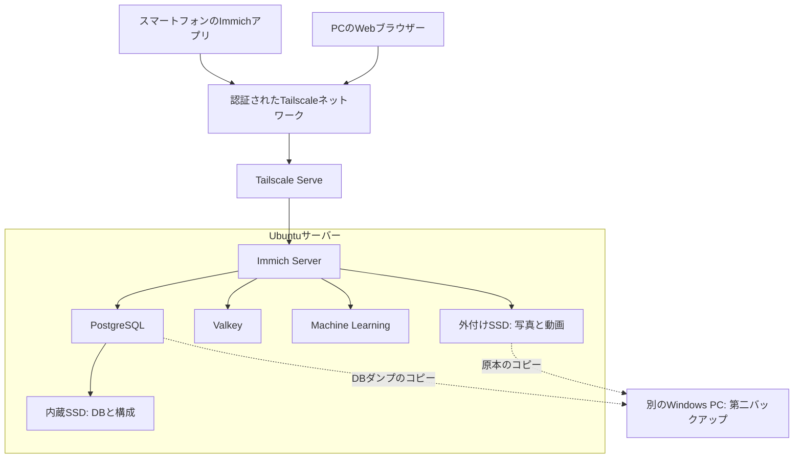

# Ubuntuでつくる自宅写真サーバー｜Immich構築・運用ガイド

自宅の写真・動画サーバーを、保存先・バックアップ・接続経路から理解するための日本語ガイドです。macminovaがまとめる**非公式の構成解説**で、Immich公式プロジェクトの提供物ではありません。

> 公開準備中。これは本番サーバーへそのまま適用するインストーラーではありません。設定例の適用試験と公開前の確認が残っています。

## 全体像



これは運用記録を匿名化した論理図です。Tailscaleの制御・中継通信など全ての通信経路を網羅するネットワーク図ではありません。

## このガイドで読むこと

1. [構成要素とデータの流れ](docs/ARCHITECTURE.md)
2. [写真とDBの保存先・バックアップ](docs/STORAGE-AND-BACKUP.md)
3. [公開範囲と安全なアクセス](docs/NETWORK.md)
4. [構築ガイドの作成順序](docs/BUILD-PLAN.md)
5. [確認できたこと・未確認事項](docs/STATUS.md)
6. [公式資料・ライセンスの扱い](docs/REFERENCES.md)

## 想定する構成

Linuxサーバー、Docker Compose、写真保存用の外付けSSD、別PCへのバックアップを組み合わせます。参考にした運用記録では、サーバーのRAMは8GB、内蔵NVMeは256GB、写真用SSDは1TBです。推奨要件や、全環境で動く保証値ではありません。

運用記録のImmichは**v3.3.6**です。この準備作業ではサーバーに接続して現在値を確認していません。公式の一般手順は更新されるため、過去の版の復元手順と最新ドキュメントを無条件に混ぜないでください。

## 設定例の位置づけ

[examples/.env.example](examples/.env.example)は保存先や版固定の書き方を示す例です。パスワードは未設定のプレースホルダーで、実用に使えません。公式Compose、実環境の.env、写真、DB、認証キーをこの公開用フォルダへ含めていません。

公式Composeを取得して設定を検証する方法は、[公式のDocker Compose手順](https://docs.immich.app/install/docker-compose/)を参照してください。Compose実行、ファイアウォール適用、バックアップ削除や復元を自動実行するスクリプトは付属しません。

## 公開前の検査

PowerShellで、公開予定フォルダを読み取り専用で検査できます。

```powershell
./tools/Test-PublishSafety.ps1
```

この検査は漏えいがないことを完全に保証しません。目視確認とGit履歴の確認も必要です。非公開の運用リポジトリを丸ごと公開せず、このフォルダを起点に新しい公開用リポジトリを作る方針です。

macminovaのショップ: https://macminova.booth.pm/

本文・設定例の公開ライセンスはまだ選定中です。Immich本体や第三者部品の権利を、このガイドの権利として扱いません。
